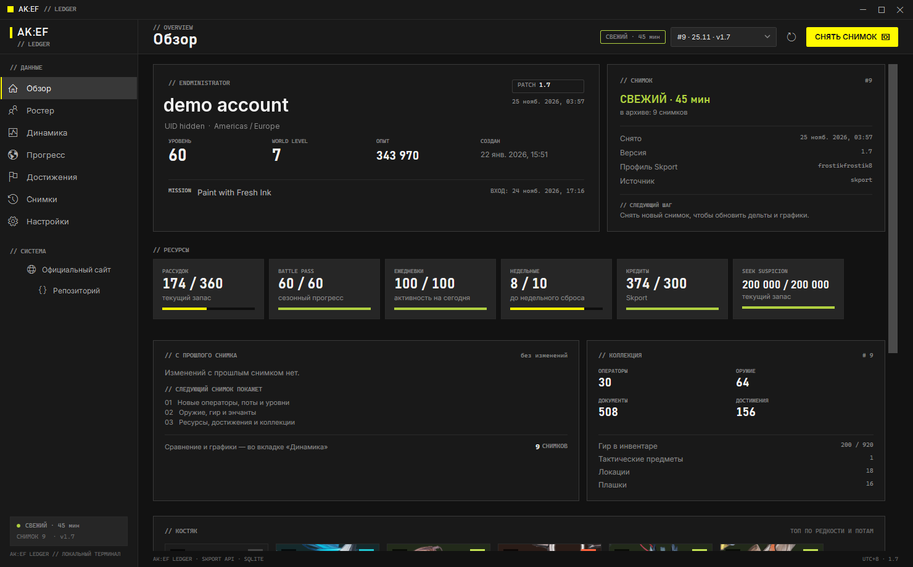
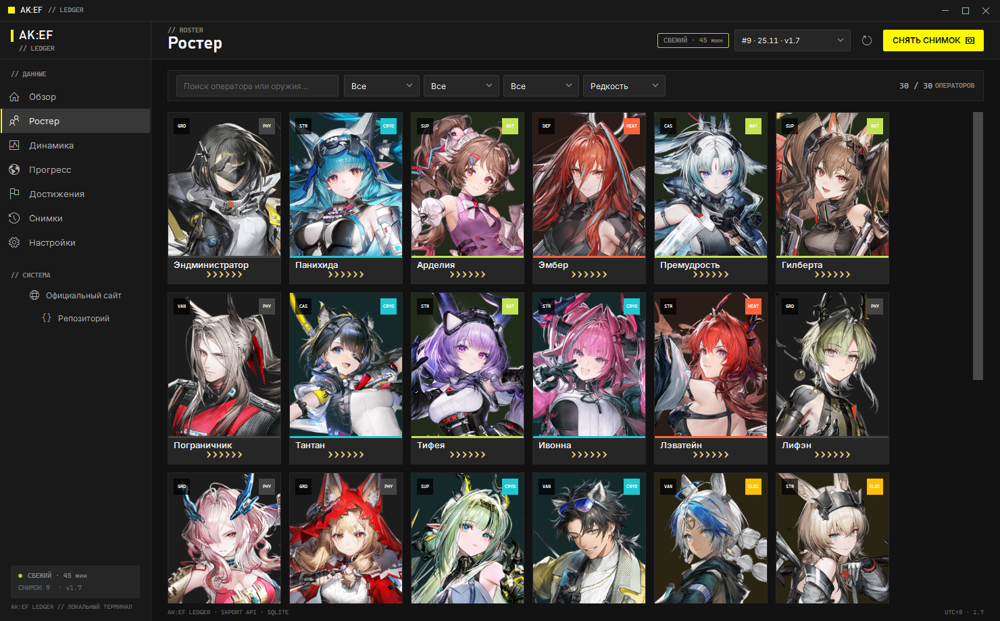
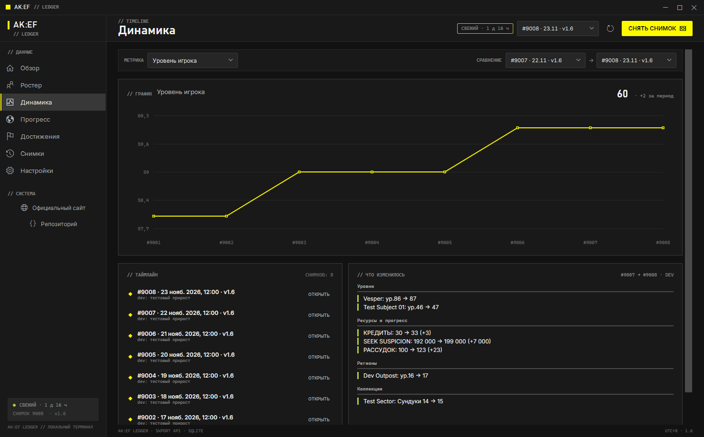
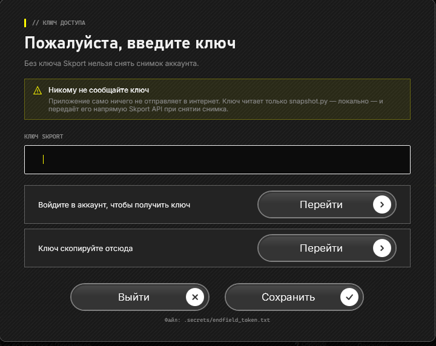
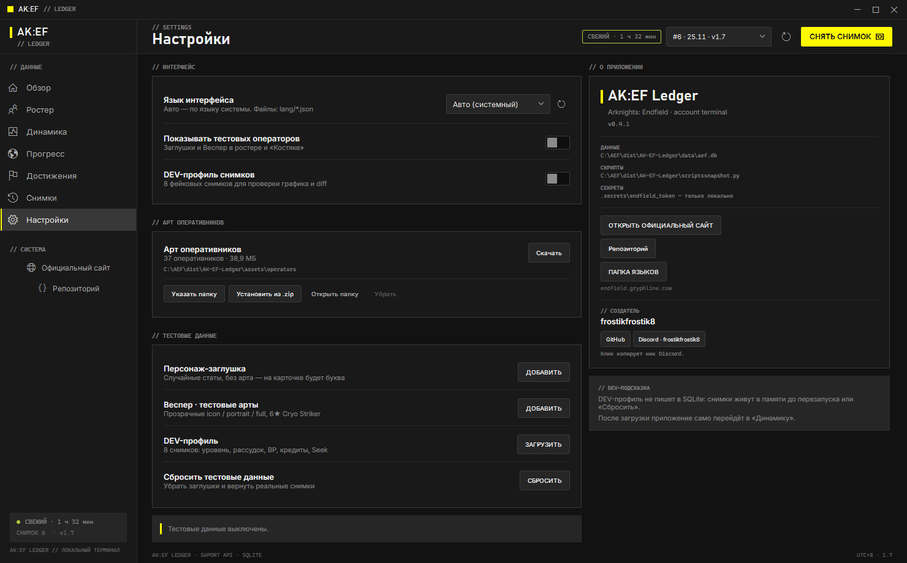

# AK:EF Ledger — Arknights: Endfield account dashboard for Windows

[English](README.md) | [Русский](README.ru.md)

> **AK:EF Ledger** is an unofficial local **Arknights: Endfield** account
> dashboard for Windows: roster, resources, achievements, regions, outposts,
> snapshot history and dynamics. Built with .NET 10 / WPF and SQLite. No web
> server, no browser, no telemetry.


<sub>AK:EF Ledger v0.4.1 · Windows 11 · 1480×920</sub>

## What it is

**AK:EF Ledger** is a desktop app for Windows that shows your **Arknights:
Endfield** account in one place. It is not a browser, a web panel or a website:
it is a regular `.exe` that reads a local SQLite database and works offline;
internet is needed for snapshots and optional operator-art downloads.

Endfield spreads useful information across several screens: how much Sanity and
credits you have, what gear an operator uses, what changed since last week, how
many achievements are done, which regions and outposts are developed. The app
collects it into an "engineering terminal": dense tables, charts, a diff between
snapshots and operator cards.

Data comes from the **Skport API** through `scripts/snapshot.py`. A snapshot is
saved to `data/aef.db` and `data/snapshots/`, so you can browse the history
offline, compare any two snapshots and not depend on what the website shows
right now.

If you searched for "Arknights: Endfield dashboard", "Endfield account tracker",
"Endfield roster viewer", "AK:EF Ledger" or "how to view Endfield resources on
PC" — this is it.

## Who it is for

- Players who want to see their **Arknights: Endfield** account as a whole,
  not one screen at a time.
- Players who keep a history: what resources were there, what changed, how the
  roster and progress grew.
- Players who do not want to give account data to third-party websites: the app
  is local, the database is yours, there is no cloud and no telemetry.
- Developers interested in a WPF app with SQLite, diff, localization and
  external assets.

## Features

- **Overview** — player, patch, Sanity, BP, dailies, weeklies, credits, Seek,
  collection counters and the diff from the previous snapshot.
- **Roster** — search by RU/EN name, filters by rarity, element and class,
  operator cards, and a detail window with weapon, gear, skills and talents.
- **Dynamics** — chart over snapshots, timeline, and A/B comparison of any two
  snapshots.
- **Progress** — regions, outposts, collections, Crisis Contract, War Echoes,
  Indie groups and inventory.
- **Achievements** — search, categories and plated badges.
- **Snapshots** — dense archive, Markdown report and raw JSON.
- **Settings** — RU/EN interface, test operators, DEV profile, art pack.
- **Skport key** — a separate first-run screen: masked input `*`, Skport links,
  and **Exit** / **Save** buttons.
- **Operator art** — an external `operators/` folder with `icon` / `portrait` /
  `full`; install from a folder, a zip or GitHub Releases.
- **No telemetry** — the app sends no analytics; network is used only for
  explicit snapshots and, if enabled, operator-art downloads.

## Screenshots

<!-- Screenshots show a local build with an optional art pack; the art files
themselves are not part of the repository. -->

| Overview | Roster |
|---|---|
|  |  |
| <sub>AK:EF Ledger v0.4.1 · 1480×920</sub> | <sub>AK:EF Ledger v0.4.1 · 1480×920</sub> |

| Dynamics | Skport key |
|---|---|
|  |  |
| <sub>AK:EF Ledger v0.4.1 · test snapshots</sub> | <sub>AK:EF Ledger v0.4.1 · 1480×920</sub> |


<sub>AK:EF Ledger v0.4.1 · Windows 11 · 1480×920</sub>

Screenshots show a local build with an optional art pack; the art files
themselves are not part of the repository.

## How it works

```text
Skport API
   ↓  scripts/snapshot.py (only when you press "Take snapshot")
data/snapshots/*.json.gz  +  data/aef.db
   ↓
AK:EF Ledger (WPF, Microsoft.Data.Sqlite)
```

The app does not fetch operator art for viewing unless **Settings → Operator
art → Download art automatically** is enabled (off by default). Python is
needed only for the snapshot updater: `snapshot.py` reads the key from
`.secrets/` and calls the Skport API. The in-app snapshot action passes
`--no-art-cache` unless **Download art automatically** is enabled. Running
`update_snapshot.cmd` directly bypasses this and may cache art.
Viewing, filters, charts and diff work fully offline.

## Key and privacy

- The Skport key is entered in the app and stored only in
  `.secrets/endfield_token.txt`.
- The app does not send the key anywhere and does not write it to logs.
- Only `snapshot.py` reads the key and passes it directly to the Skport API.
- `data/aef.db`, `data/snapshots/` and `.secrets/` are not committed.
- No cloud, no accounts, no analytics. Network is used only for explicit
  snapshots and, if enabled, operator-art downloads.

## Translation

The UI translation is a **draft**: RU/EN already exist, but wording and terms
will be refined. Strings that come from the API — achievement names, weapons,
regions and items — are currently shown as a **direct translation without
adaptation**. In the future they will be properly translated and adapted.

## Project status

The project is under active development. This is **not** a final product: the
UI, database schema and snapshot format may change. **Old snapshots may stop
working after an update** — back up `data/` before upgrading.

The repository is **public**. The main app build contains no real operator art
and no keys; the art pack is a separate release. See the
[releases](https://github.com/frostikfrostik8/ak-ef-ledger/releases).

**v0.4.4** fixes art loading/snapshot switching and makes automatic art
download opt-in (off by default); **v0.4.3** added operator-art caching and
`char_id` lookup. README screenshots are from v0.4.1.

## Installation (release package)

1. Install **.NET 10 Desktop Runtime** and **Python 3.10+**.
2. Download the latest release and extract it.
3. Create the database: `init_db.cmd`.
4. Paste the Skport key into the first-run window, or into
   `.secrets/endfield_token.txt` (one line, no quotes).
5. Take the first snapshot: `update_snapshot.cmd`.
6. Start: `launch.cmd` or `AkEfLedger.exe`.

Operator art is not part of the main app package: the app falls back to the
first letter of the name, and the art pack is installed separately in
**Settings → Operator art**.

## Build from source

Requires **.NET 10 SDK**.

```powershell
cd ak-ef-ledger
.\build.cmd
.\run.cmd
```

`build.cmd` copies `data/schema.sql` and `scripts/*.py` into
`src/AefAccount/publish`. If there is no database yet, run
`python scripts\aef.py init` from `src\AefAccount\publish`.

## FAQ

**What is Arknights: Endfield?**
A tactical open-world game by Hypergryph/Gryphline, a continuation of the
Arknights universe. An account stores the roster, resources, achievements and
progress.

**Is this an official app?**
No. AK:EF Ledger is an unofficial fan project, not affiliated with HYPERGRYPH,
GRYPHLINE or Skport.

**Where does the data come from?**
From the Skport API through `scripts/snapshot.py`. The app only reads the local
SQLite database.

**Does it work offline?**
Yes for viewing, filters, charts and diff. Internet is needed to take a new
snapshot and, optionally, to download missing operator-art images.

**Is it safe to enter the key?**
The key is stored locally in `.secrets/`, is not logged and is not sent by the
app. Only `snapshot.py` uses it for the Skport API call.

**Why are operator arts missing?**
Official art is copyrighted and large. It is not part of the main app package;
the art pack is installed separately.

**Will old snapshots keep working?**
Not guaranteed. The format may change; back up `data/` before upgrading.

**Why isn't the translation perfect?**
The translation is a draft. API strings (achievements, weapons, regions) are
shown as-is; they will be translated in the future.

## License

MIT. Arknights: Endfield, its names, characters and art belong to
HYPERGRYPH / GRYPHLINE. This is an unofficial project.
