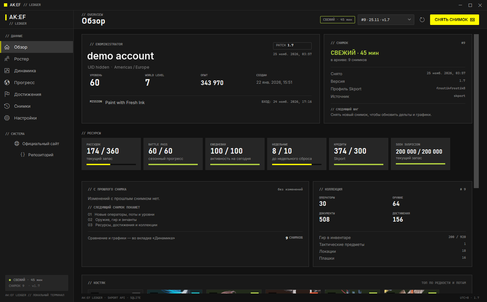
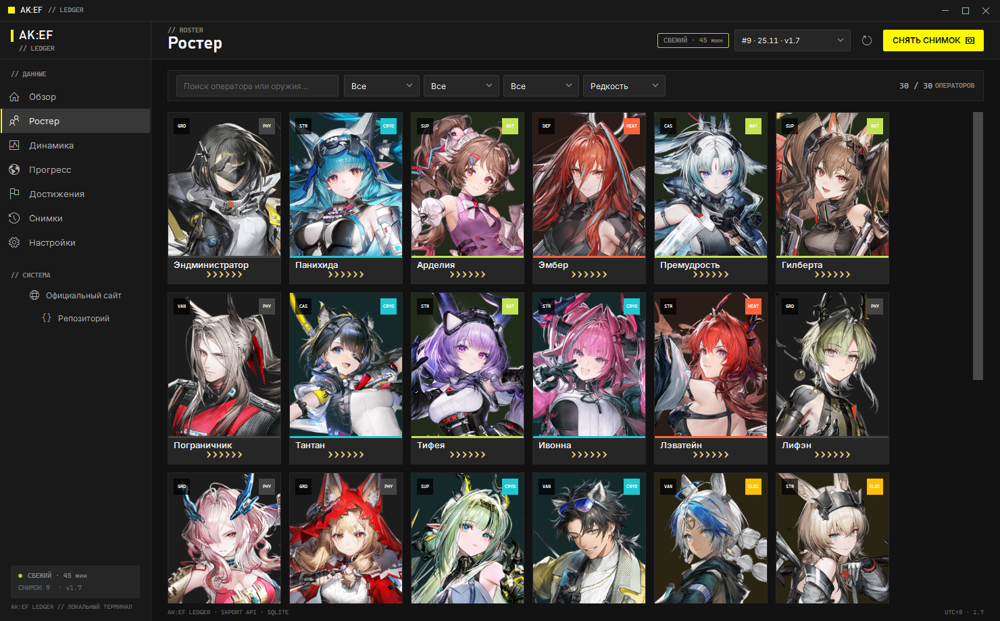
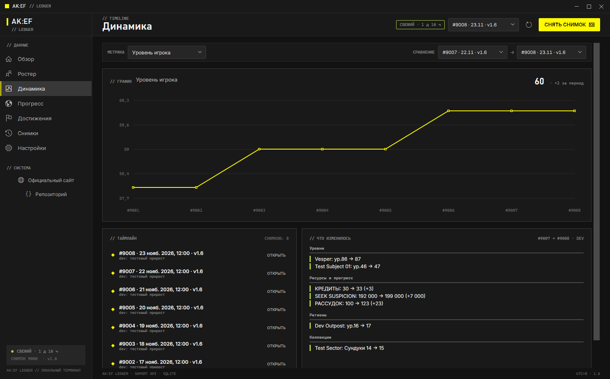
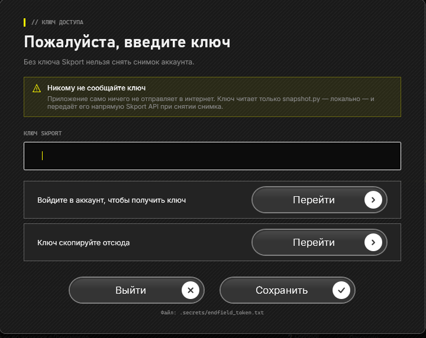
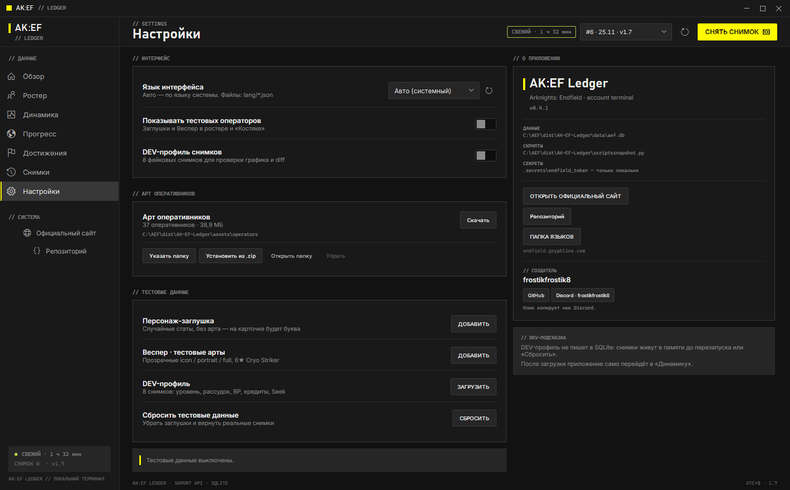

# AK:EF Ledger — дашборд аккаунта Arknights: Endfield для Windows

[English](README.md) | [Русский](README.ru.md)

> **AK:EF Ledger** — неофициальный локальный дашборд для **Arknights: Endfield**:
> ростер, ресурсы, достижения, регионы, история снимков и динамика. Windows,
> .NET 10 / WPF, SQLite. Без веб-сервера, без телеметрии, без облака.
>
> **AK:EF Ledger** is an unofficial local **Arknights: Endfield** account dashboard
> for Windows: roster, resources, achievements, regions, snapshot history and
> dynamics. Built with .NET 10 / WPF and SQLite. No web server, no telemetry.


<sub>AK:EF Ledger v0.4.1 · Windows 11 · 1480×920</sub>

## Что это

**AK:EF Ledger** — настольное приложение для Windows, которое показывает
состояние твоего аккаунта в **Arknights: Endfield** на ПК. Не браузер, не
веб-панель и не сайт: обычный `.exe`, который читает локальную базу SQLite и
работает офлайн; интернет нужен для снимка и опциональной загрузки артов
операторов.

Endfield — игра, где полезная информация размазана по экранам: сколько
рассудка и кредитов, какой у оператора гир, что изменилось с прошлой недели,
сколько достижений закрыто, какие регионы и аванпосты прокачаны. Приложение
собирает это в один «инженерный терминал»: плотные таблицы, графики, diff
между снимками и карточки операторов.

Данные приходят из **Skport API** через `scripts/snapshot.py`. Снимок
сохраняется в `data/aef.db` и `data/snapshots/`, поэтому историю можно
смотреть офлайн, сравнивать любые два снимка и не зависеть от того, что
показывает сайт сейчас.

Если ты искал «Arknights: Endfield дашборд», «Endfield трекер аккаунта»,
«Endfield roster viewer», «AK:EF Ledger» или «как посмотреть ресурсы
Endfield на ПК» — это оно.

## Кому это нужно

- Тем, кто играет в **Arknights: Endfield** на ПК и хочет видеть аккаунт
  целиком, а не по кускам в меню игры.
- Тем, кто ведёт историю: сколько ресурсов было, что изменилось, как рос
  ростер и прогресс.
- Тем, кто не хочет отдавать данные аккаунта сторонним веб-сайтам: приложение
  локальное, база лежит у тебя, облака и телеметрии нет.
- Разработчикам, которым интересен пример WPF-приложения с SQLite, diff,
  локализацией и внешними ассетами.

## Возможности

- **Обзор** — игрок, патч, рассудок, BP, ежедневки, недельные, кредиты, Seek,
  коллекция и diff с предыдущим снимком.
- **Ростер** — поиск по RU/EN, фильтры по редкости, стихии и классу, карточки
  операторов, детальное окно с оружием, гиром, скиллами и талантами.
- **Динамика** — график по снимкам, таймлайн и сравнение любых двух снимков.
- **Прогресс** — регионы, аванпосты, коллекции, Crisis Contract, War Echoes,
  Indie-группы и инвентарь.
- **Достижения** — поиск, категории, плашки.
- **Снимки** — плотный архив, Markdown-отчёт и сырой JSON.
- **Настройки** — RU/EN, тестовые операторы, DEV-профиль, арт-пак.
- **Ключ Skport** — отдельный экран при первом запуске: маска `*`, ссылки на
  Skport, кнопки «Выйти» и «Сохранить».
- **Арт операторов** — внешняя папка `operators/` с `icon` / `portrait` / `full`,
  установка из папки, zip или GitHub Releases.
- **Без телеметрии** — приложение не отправляет аналитику; сеть нужна только
  для явных снимков и, если включена опция, для догрузки арта.

## Скриншоты

| Обзор | Ростер |
|---|---|
|  |  |
| <sub>AK:EF Ledger v0.4.1 · 1480×920</sub> | <sub>AK:EF Ledger v0.4.1 · 1480×920</sub> |

| Динамика | Ключ Skport |
|---|---|
|  |  |
| <sub>AK:EF Ledger v0.4.1 · тестовые снимки</sub> | <sub>AK:EF Ledger v0.4.1 · 1480×920</sub> |


<sub>AK:EF Ledger v0.4.1 · Windows 11 · 1480×920</sub>

Скриншоты показывают локальную сборку с опциональным арт-паком; сами файлы
артов в репозиторий не входят.

## Как это работает

```text
Skport API
   ↓  scripts/snapshot.py (только по кнопке «Снять снимок»)
data/snapshots/*.json.gz  +  data/aef.db
   ↓
AK:EF Ledger (WPF, Microsoft.Data.Sqlite)
```

Приложение не скачивает арт операторов для просмотра, если в
**Настройки → Арт оперативников → Скачивать арт автоматически** не включена
эта опция (по умолчанию выключена). Python нужен только для обновления
снимка: `snapshot.py` читает ключ из `.secrets/` и обращается к Skport API.
Снимок — явное действие; кнопка «Снять снимок» в приложении при выключенной
автодогрузке передаёт `--no-art-cache`. Прямой запуск `update_snapshot.cmd`
этот флаг не добавляет и может кэшировать арт. Просмотр, фильтры, графики и
diff работают полностью офлайн.

## Ключ и приватность

- Ключ Skport вводится в приложении и лежит только в `.secrets/endfield_token.txt`.
- Приложение не отправляет ключ в сеть и не пишет его в логи.
- Ключ читает только `snapshot.py` и передаёт его напрямую Skport API.
- `data/aef.db`, `data/snapshots/` и `.secrets/` не коммитятся в репозиторий.
- Приложение не использует облако, аккаунты и аналитику. Сеть нужна только
  для явных снимков и, если включена опция, для догрузки арта.

## Перевод

Перевод интерфейса **черновой**: RU/EN уже есть, но формулировки и термины
будут уточняться. Строки, которые приходят из API — названия достижений,
оружия, регионов и предметов — сейчас показываются как **прямой перевод без
адаптации**. В будущем они будут нормально переведены и адаптированы.

## Статус проекта

Проект в активной разработке. Это **не** финальный продукт: интерфейс, формат
базы и снимков могут меняться. **Теоретически старые снимки могут перестать
открываться после обновления** — перед обновлением делай копию `data/`.

Репозиторий **открыт**. Основная сборка приложения не содержит реальных артов
операторов и ключей; арт-пак — отдельный релиз. Скачать:
[github.com/frostikfrostik8/ak-ef-ledger/releases](https://github.com/frostikfrostik8/ak-ef-ledger/releases).

**v0.4.4** — исправление загрузки артов и переключения снимков; автодогрузка
арта теперь опция, по умолчанию выключена. **v0.4.3** — кэш артов операторов
и поиск по `char_id`. Скриншоты сняты на v0.4.1.

## Установка (пакет релиза)

1. Установи **.NET 10 Desktop Runtime** и **Python 3.10+**.
2. Скачай последний релиз и распакуй архив:
   [releases](https://github.com/frostikfrostik8/ak-ef-ledger/releases).
3. Создай базу: `init_db.cmd`.
4. Вставь ключ Skport в окно приложения при первом запуске или в
   `.secrets/endfield_token.txt` (одна строка, без кавычек).
5. Сними первый снимок: `update_snapshot.cmd`.
6. Запусти: `launch.cmd` или `AkEfLedger.exe`.

Арт операторов не входит в публичный пакет: приложение работает с буквами
вместо портретов, а арт-пак ставится отдельно в **Настройки → Арт
оперативников**.

## Сборка из исходников

Нужен **.NET 10 SDK**.

```powershell
cd ak-ef-ledger
.\build.cmd
.\run.cmd
```

`build.cmd` копирует `data/schema.sql` и `scripts/*.py` в
`src/AefAccount/publish`. Если БД ещё нет: перейди в `src\AefAccount\publish`
и выполни `python scripts\aef.py init`.

## FAQ

**Что такое Arknights: Endfield?**
Тактика с открытым миром от Hypergryph/Gryphline, продолжение вселенной
Arknights. Аккаунт хранит ростер, ресурсы, достижения и прогресс.

**Это официальное приложение?**
Нет. AK:EF Ledger — неофициальный фанатский проект, не связан с HYPERGRYPH,
GRYPHLINE или Skport.

**Откуда берутся данные?**
Из Skport API через `scripts/snapshot.py`. Приложение только читает
локальную SQLite.

**Нужен ли интернет?**
Чтобы снять новый снимок и, опционально, догрузить отсутствующие арты
операторов. Просмотр, графики и diff работают офлайн.

**Безопасно ли вводить ключ?**
Ключ хранится локально в `.secrets/`, не логируется и не отправляется
приложением. Его читает только `snapshot.py` для запроса к Skport API.

**Почему нет артов операторов?**
Официальные арты — чужие права и большой объём. В репозиторий они не
входят; арт-пак ставится отдельно.

**Будут ли работать старые снимки?**
Не гарантируется. Формат может меняться; делай копию `data/` перед
обновлением.

**Почему перевод не идеальный?**
Перевод черновой. Строки из API (достижения, оружие, регионы) показываются
как есть; в будущем они будут переведены.

## Лицензия

MIT. Arknights: Endfield, названия, персонажи и арты принадлежат
HYPERGRYPH / GRYPHLINE. Проект неофициальный и не претендует на права
правообладателей.

